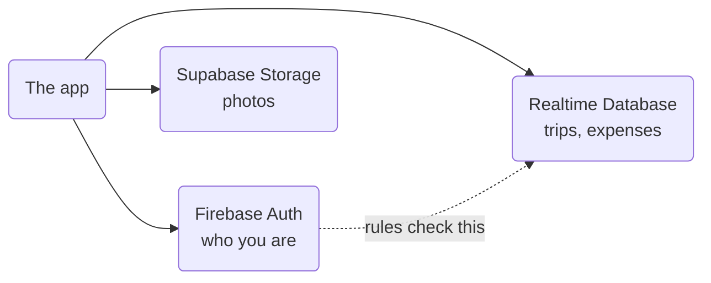

# TripSplit

Split trip costs with friends — expenses, balances, settlements and an itinerary,
for groups travelling together in the Philippines.

Built with Expo (React Native) and TypeScript. Runs on Android, iOS and web.

---

## What it does

- **Trips** — create a trip, invite people with a code or a QR, set a budget.
- **Expenses** — log what was spent, who paid, and who shares the cost. Supports
  several payers on one bill, itemised receipts, percentage and custom splits,
  receipt photos and repeating expenses.
- **Balances** — who owes whom, reduced to the fewest payments that settle it.
- **Settlements** — record cash changing hands, with the receiver confirming it.
- **Itinerary** — plans with times, places and photos, shown on a timeline.
- **Reports** — spending over time, by category, and per trip.
- **Edit logs** — every change to a money record is kept, with who changed what.

Works offline: changes are queued and sent when the connection comes back.

---

## Two backends, on purpose

This is the part that surprises people, so it is worth stating plainly:

| Backend                        | What it holds                                                          | Why                                                                             |
| ------------------------------ | ---------------------------------------------------------------------- | ------------------------------------------------------------------------------- |
| **Firebase Realtime Database** | All app data — trips, expenses, settlements, plans, users, friendships | Live-syncing JSON, and security rules that can check trip membership per record |
| **Firebase Auth**              | Sign-in sessions                                                       | The database rules rely on it: every rule starts with `auth != null`            |
| **Supabase Storage**           | Uploaded files — profile photos and receipt photos                     | Cheap object storage with signed links for a private bucket                     |

So: **Firebase for data and identity, Supabase for files only.** No app data is
stored in Supabase, and no files are stored in Firebase.



### Security rules

The rules live in `database.rules.json` and are deployed to Firebase — they are
**not** shipped in the app, so a change in the file does nothing until it is
deployed:

```bash
npx firebase deploy --only database
```

Always deploy after editing the rules. Keep the file in sync with the console;
a stale file is how a plan edit was once refused with `PERMISSION_DENIED` while
the app itself looked correct.

---

## Running the app

```bash
npm install
npm start          # then scan the QR with Expo Go
npm run android    # or build and install on a phone or emulator
npm run ios        # needs Xcode (macOS only)
npm run web
```

The app name and icon are baked into the native build, so after changing them in
`app.json` you must regenerate the native folders and rebuild:

```bash
npx expo prebuild --clean
npm run android
```

`ios/` and `android/` are gitignored — `app.json` is the source of truth.

### Environment

Create a `.env` with these keys (see `.env.example` if present):

```
EXPO_PUBLIC_FIREBASE_API_KEY=
EXPO_PUBLIC_FIREBASE_APP_ID=
EXPO_PUBLIC_FIREBASE_AUTH_DOMAIN=
EXPO_PUBLIC_FIREBASE_DATABASE_URL=
EXPO_PUBLIC_FIREBASE_PROJECT_ID=
EXPO_PUBLIC_SUPABASE_URL=
EXPO_PUBLIC_SUPABASE_ANON_KEY=
```

Only Supabase's `anon` key is used in the app; the bucket is private and files
are read through signed links.

---

## Checks

```bash
npm test           # maths tests for splitting, balances and stats
npm run lint       # ESLint
npx tsc --noEmit   # types
```

CI runs all three on every push and pull request
(`.github/workflows/ci.yml`).

---

## Layout

```
src/
  app/            screens (Expo Router — file name is the route)
  components/     UI, grouped by area (trip, dashboard, ui, ...)
  services/       Firebase data + Supabase uploads + the offline queue
  utils/          pure logic: split, balance, stats, money, dates
  types/          shared TypeScript types
tests/            node:test files for the pure logic in utils/
public/j.html     the small page a scanned join QR opens
```

The join page lives at `public/j.html` on purpose, not `public/index.html`: the
dev server serves anything in `public/` before the app, so an `index.html` there
would swallow `localhost:<port>/` and you would never see the app in a browser.
The Firebase rewrites in `firebase.json` still send `/j` and `/` to it on the
live site.

The maths that decides who owes whom lives in `src/utils/split.ts` and
`src/utils/balance.ts`, and is covered by `tests/`. Everything works in cents so
shares always add back to the total.
